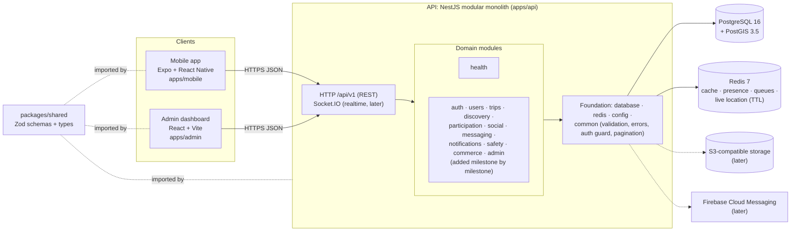

# Voyago architecture

Voyago is a mobile-first social discovery platform for motorcycle rides (**Ride** mode) and group
travel (**Travel** mode), launching in Bengaluru. This document describes the system as it stands
and the boundaries later milestones build inside.

## System overview

Dashed lines are integrations planned for later milestones. Nothing in the codebase pretends they
exist yet.

## Repository layout

| Path              | What it is                                                                |
| ----------------- | ------------------------------------------------------------------------- |
| `apps/api`        | NestJS backend. REST under `/api/v1`, OpenAPI at `/api/docs`.             |
| `apps/mobile`     | Expo Router app: Home, Explore, Create, Inbox, Profile tabs.              |
| `apps/admin`      | React + Vite admin dashboard.                                             |
| `packages/shared` | Zod schemas and TypeScript types shared by all three apps.                |
| `infra/docker`    | Docker Compose for local PostgreSQL/PostGIS and Redis.                    |
| `docs`            | This file, `DEVELOPMENT_PROGRESS.md`, and ADRs in `docs/decisions/`.      |
| `.github`         | CI: format, typecheck, lint, unit tests, API smoke test against real DBs. |

## Backend: modular monolith

One deployable NestJS app, split by domain. Rules every module follows:

1. A module owns its tables. Other modules call its exported service, never its Prisma queries.
2. Input is validated with Zod schemas from `@voyago/shared` (`ZodValidationPipe`).
3. Authorization is enforced on the server, in guards and service-level policy checks.
4. Errors leave the API in one shape (`ApiError` in `@voyago/shared`):
   `statusCode`, `error`, `message`, `requestId`, `timestamp`, `path`, optional `details`.
   Unknown errors become a generic 500; internals are never sent to clients.
5. Cross-module side effects go through domain events; anything that must not be lost uses an
   outbox table (introduced with notifications).

Planned modules and the milestone that introduces each:

| Module          | Responsibility                                                    | Milestone |
| --------------- | ----------------------------------------------------------------- | --------- |
| `health`        | Liveness and dependency status                                    | 1 (done)  |
| `auth`, `users` | Accounts, sessions, profiles, travel preferences, privacy, blocks | 4         |
| `vehicles`      | Motorcycle profiles                                               | 4         |
| `trips`         | Rides and travel trips, one model with `mode` = `RIDE` / `TRAVEL` | 5         |
| `discovery`     | Search, filters, PostGIS radius queries                           | 6         |
| `participation` | Join requests, approvals, participant roles                       | 7         |
| `social`        | Follows and communities                                           | 8         |
| `messaging`     | Trip group chat (Socket.IO)                                       | 9         |
| `notifications` | In-app and FCM push                                               | 9         |
| `admin`         | Moderation and back office                                        | 10        |
| `safety`        | Reports, SOS, opt-in time-limited live location                   | 11        |
| `commerce`      | Verified operators, packages, bookings, payments, subscriptions   | 12 to 14  |

Paid passenger transport, driver matching and ride-hailing are out of scope (legal review needed).

## Cross-cutting foundations (milestone 1)

| Concern        | Implementation                                                                                                                           |
| -------------- | ---------------------------------------------------------------------------------------------------------------------------------------- |
| Configuration  | `apps/api/src/config/env.schema.ts`: Zod-validated env; the API exits on startup if anything is invalid.                                 |
| Logging        | `nestjs-pino`: JSON logs, request id per request (`x-request-id`), secrets and personal data redacted, path logged without query string. |
| Errors         | `AllExceptionsFilter` → shared `ApiError` shape.                                                                                         |
| HTTP hardening | Helmet headers, CORS allowlist from `CORS_ORIGINS`, global rate limit (`@nestjs/throttler`).                                             |
| API docs       | OpenAPI generated from controllers, served at `/api/docs` (JSON at `/api/docs-json`).                                                    |
| Database       | Prisma 7 with the `pg` driver adapter; migrations in `apps/api/prisma/migrations`; PostGIS enabled.                                      |
| Health         | `GET /api/v1/health` → 200 when Postgres, PostGIS and Redis are up, 503 with details otherwise.                                          |

## Privacy and safety principles

These are product rules the architecture must keep true as features land:

- Phone numbers, emails and exact locations never appear in public API payloads.
- Exact meeting points are visible only to approved trip participants.
- Live location is opt-in, scoped to one trip, and expires automatically (Redis TTL).
- Blocking, reporting and core safety features are free for everyone.
- Only verified commercial operators can publish paid packages, kept separate from free community trips.

## Mobile and admin

- **Mobile:** Expo SDK 58, Expo Router (typed routes), TanStack Query for server state, Zustand for
  local state (the global Ride / Travel mode). One token set drives light and dark themes.
- **Admin:** React 19 + Vite + React Router + TanStack Query, responsive layout, light and dark.

Both clients read the API base URL from env (`EXPO_PUBLIC_API_BASE_URL`, `VITE_API_BASE_URL`) and
validate API responses with the shared Zod schemas.
