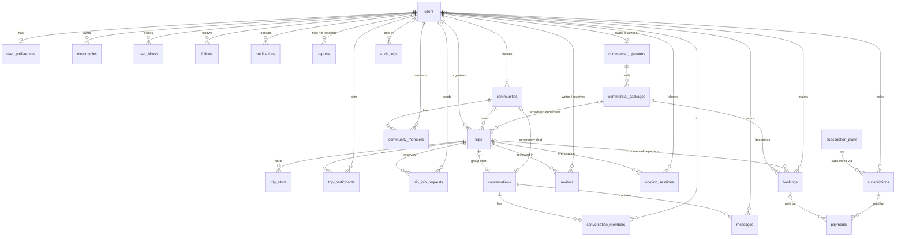

# Voyago database

PostgreSQL 16 with PostGIS 3.5 and citext, managed by Prisma 7. The schema lives in
`apps/api/prisma/schema.prisma`; migrations live in `apps/api/prisma/migrations`. Rules that
Prisma cannot express (CHECK constraints, partial unique indexes, triggers) are hand-written at the
end of the initial migration and are covered by tests in
`apps/api/test/database-constraints.e2e-spec.ts`.

## Conventions

| Rule          | How                                                                                                                         |
| ------------- | --------------------------------------------------------------------------------------------------------------------------- |
| Primary keys  | `uuid`, generated by Postgres (`gen_random_uuid()`), so raw SQL inserts get ids too.                                        |
| Naming        | snake_case tables and columns (`@@map` / `@map`); Prisma models are PascalCase.                                             |
| Time          | `timestamptz(3)`, always UTC. `created_at` on every table; `updated_at` (Prisma `@updatedAt`) on mutable ones.              |
| Money         | Integer **paise** in `*_paise` columns (`int4`, max ₹2.1 crore per row), with a `currency` `char(3)` (`INR`). Never floats. |
| Text identity | `username`, `email`, community and operator `slug` are `citext`: unique regardless of case.                                 |
| Enums         | Postgres enums for stable lifecycle states (trip status, join request status, booking status, ...).                         |
| Locations     | `geography(Point, 4326)` with GiST indexes. Written via `apps/api/src/infra/prisma/geo.ts`.                                 |
| Soft delete   | `deleted_at` on users, trips, communities, messages. Users are never hard-deleted while they own trips.                     |
| Files         | Object-storage keys (`*_key`), never URLs or binary data.                                                                   |

## Entity relationship diagram



## Tables

| Area       | Table                                               | Purpose                                                                                          |
| ---------- | --------------------------------------------------- | ------------------------------------------------------------------------------------------------ |
| People     | `users`                                             | Account and public profile. Email and phone are private.                                         |
|            | `user_preferences`                                  | Mode, interests, budget range, privacy and notification settings (1:1 with users).               |
|            | `user_blocks`                                       | Safety blocks. Not in the spec's list; added because blocking is a free core safety feature.     |
|            | `motorcycles`                                       | Riders' bikes (no registration plates stored).                                                   |
| Auth       | `auth_sessions`                                     | One row per refresh token (SHA-256 hash only). Rotation chain and revocation reason.             |
|            | `auth_identities`                                   | Linked Google / Apple accounts (`provider` + provider subject id).                               |
|            | `otp_challenges`                                    | Phone sign-in codes: HMAC of the code, attempts, expiry. Never the code itself.                  |
|            | `verification_tokens`                               | Email verification and password reset links (SHA-256 hash only, single use).                     |
| Trips      | `trips`                                             | Rides and travel trips. One model; `mode` is `RIDE` or `TRAVEL`.                                 |
|            | `trip_stops`                                        | Ordered route stops with a geography point.                                                      |
|            | `trip_participants`                                 | Who is on a trip and in what role.                                                               |
|            | `trip_join_requests`                                | Requests the organiser approves or rejects.                                                      |
| Social     | `communities`, `community_members`, `follows`       | Communities and the follow graph.                                                                |
| Messaging  | `conversations`, `conversation_members`, `messages` | Trip group chats, community chats, direct messages.                                              |
|            | `notifications`                                     | In-app notification inbox.                                                                       |
| Safety     | `reviews`                                           | Post-trip review of one participant by another (usually of the organiser).                       |
|            | `reports`                                           | User reports of people, trips, posts or messages, with severity and a moderation workflow.       |
|            | `location_sessions`                                 | Opt-in live location sessions, max 24 hours. Coordinates are kept in Redis with a TTL, not here. |
| Commercial | `commercial_operators`                              | Businesses; must be `VERIFIED` to sell.                                                          |
|            | `operator_documents`                                | Verification documents (private files, reviewed by staff).                                       |
|            | `commercial_packages`                               | Paid experiences. Never passenger transport.                                                     |
|            | `bookings`, `payments`                              | Purchases and gateway payment records (no card data).                                            |
|            | `subscription_plans`, `subscriptions`               | Explorer Pro / Organiser Pro.                                                                    |
| Audit      | `audit_logs`                                        | Append-only log of privileged and financial actions.                                             |

## Privacy rules in the schema

- **Exact user location is never stored.** Users have a city-level `home_city` only. Live location
  pings live in Redis with a TTL; `location_sessions` stores only who, which trip and when it expires.
- **Trip `origin` is the exact meeting point.** APIs must return only `origin_name` (or a coarsened
  point) to the public, and the exact point only to approved participants (enforced in milestone 06/07).
- **Contact details are private.** `users.email` and `users.phone` are never part of public payloads.
- **No date of birth or gender.** Removed in milestone 04: there is no product or legal need yet.
- **No secrets at rest in plain form.** Passwords are Argon2id hashes; refresh tokens and email
  links are SHA-256 hashes; OTP codes are HMAC-SHA-256 with a server secret.
- **No card data.** `payments` stores gateway order/payment ids, amounts and status only.
- **Notifications and audit metadata** carry ids, not personal data.

## Free community trips vs commercial bookings

The schema itself prevents a free community trip from turning into a paid listing:

| Rule                                                                                                                   | Enforced by                                             |
| ---------------------------------------------------------------------------------------------------------------------- | ------------------------------------------------------- |
| `trip_type = COMMERCIAL_PAID` if and only if a `commercial_package_id` is set                                          | CHECK `trips_commercial_requires_package`               |
| Community trips have no price; `estimated_budget_paise` is a cost-sharing estimate and only allowed on community trips | CHECK `trips_commercial_has_no_budget_estimate`         |
| Bookings may only reference `COMMERCIAL_PAID` trips of the same package                                                | trigger `bookings_enforce_commercial_trip`              |
| Commercial trips require a `VERIFIED` operator                                                                         | trigger `trips_enforce_verified_operator`               |
| Packages can only be `PUBLISHED` by a `VERIFIED` operator                                                              | trigger `commercial_packages_enforce_verified_operator` |
| Community organisers and commercial operators are separate entities                                                    | `commercial_operators` table, 1 per user                |

There is no fare, seat price or driver concept anywhere on community trips, and no ride-hailing
or passenger transport entity in the schema.

## Constraints

| Constraint                                                                      | Why                                                                                           |
| ------------------------------------------------------------------------------- | --------------------------------------------------------------------------------------------- |
| `users.username` unique (citext), format `^[A-Za-z0-9_.]{3,30}$`                | Handles are unique regardless of case and safe in URLs.                                       |
| `users.email`, `users.phone` unique; phone in E.164                             | One account per contact; consistent format for OTP later.                                     |
| `follows`, `user_blocks`: composite PK, no self-relation                        | No duplicate follows/blocks, no following yourself.                                           |
| `community_members` composite PK                                                | One membership per user per community.                                                        |
| `trip_participants` unique `(trip_id, user_id)`                                 | A user joins a trip at most once.                                                             |
| `trip_participants_one_organiser` (partial unique)                              | Exactly one organiser per trip.                                                               |
| `trip_join_requests` unique `(trip_id, user_id)`                                | One request row per user per trip; re-requests update it.                                     |
| `trips_mode_matches_activity`                                                   | Ride mode ⇔ `MOTORCYCLE_RIDE` (same on packages).                                             |
| `trips_published_has_locations`                                                 | Only drafts may lack origin/destination points.                                               |
| `trips_participant_limits`, `trips_return_after_departure`                      | Sane group sizes (2 to 500) and dates.                                                        |
| `trip_stops` unique `(trip_id, position)`, position ≥ 1                         | Ordered route without duplicates.                                                             |
| `motorcycles_one_primary_per_owner` (partial unique)                            | One primary bike per rider.                                                                   |
| `conversations_parent_matches_type`                                             | A trip chat has a trip, a community chat a community, a DM a `direct_key`.                    |
| `messages_content_present`                                                      | Text messages have text; images have an attachment; system messages have no sender.           |
| `reviews` unique `(trip_id, reviewer_id, reviewee_id)`, rating 1 to 5, not self | One review per pair per trip.                                                                 |
| `location_sessions_time_limited`                                                | Live location expires within 24 hours.                                                        |
| `location_sessions_one_active` (partial unique)                                 | One active session per user per trip.                                                         |
| Money columns: non-negative / positive, `currency ~ ^[A-Z]{3}$`                 | No negative prices; ISO currency codes.                                                       |
| `bookings_total_matches`                                                        | `total = unit_price × seats + platform_fee`.                                                  |
| `payments_exactly_one_purpose`                                                  | A payment is for a booking or a subscription, never both or neither.                          |
| `payments_refund_within_amount`                                                 | Refunds never exceed the amount paid.                                                         |
| `payments.idempotency_key` unique; `(provider, provider_payment_id)` unique     | Retries never double-charge; gateway ids are unique.                                          |
| `subscriptions_one_live_per_user` (partial unique)                              | At most one trialing/active/past-due subscription per user.                                   |
| `audit_logs_append_only` (trigger)                                              | Audit rows cannot be edited or deleted (except the FK nulling `actor_id` on account erasure). |
| `reports_resolution`, `reports_evidence_refs_count`                             | Resolved reports carry a resolution time; at most 20 evidence references.                     |
| `trips_hidden_reason`                                                           | A hidden trip always records why.                                                             |
| `commercial_operators_verified_by`                                              | Verification is a person's decision: who and when are always recorded.                        |
| `operator_documents_storage_key_format`, `_format`, `_review`                   | Private files in the operator-docs folder, known formats, reviewed ⇔ review time.             |

### Delete behaviour

| Relationship                                                                                                 | On delete | Reason                                                          |
| ------------------------------------------------------------------------------------------------------------ | --------- | --------------------------------------------------------------- |
| Trip → stops, participants, join requests, chat, reviews, location sessions                                  | Cascade   | They have no meaning without the trip.                          |
| User → preferences, bikes, blocks, follows, memberships, notifications                                       | Cascade   | Personal data goes with the account.                            |
| User → organised trips, created communities, operator, bookings, payments, subscriptions                     | Restrict  | Users are soft-deleted; history and money records must survive. |
| User → messages (sender), reports (reporter / reported / assignee), audit logs (actor), join request decider | Set null  | Keep the record, drop the link.                                 |
| Community → trips                                                                                            | Set null  | A trip survives its community.                                  |
| Package → trips, bookings; operator → packages                                                               | Restrict  | Commercial and financial history cannot disappear.              |

## Indexes

| Index                                                                                                                | Serves                                           |
| -------------------------------------------------------------------------------------------------------------------- | ------------------------------------------------ |
| `trips (status, departure_at)`, `trips (mode, status, departure_at)`                                                 | Discovery: upcoming published trips, by mode.    |
| GiST on `trips.origin`, `trips.destination`, `trip_stops.location`, `commercial_packages.destination`                | Radius and nearest searches (`ST_DWithin`).      |
| `trips (organiser_id)`, `(community_id)`, `(commercial_package_id)`                                                  | "My trips", community trips, package departures. |
| `trip_participants (user_id, status)`, `trip_join_requests (trip_id, status)`, `(user_id, status)`                   | Organiser inbox, "my requests".                  |
| `messages (conversation_id, created_at DESC, id DESC)`                                                               | Cursor-paginated chat history.                   |
| `notifications (user_id, created_at DESC)`, `(user_id, read_at)`                                                     | Inbox and unread count.                          |
| `follows (followee_id)`, `user_blocks (blocked_id)`, `community_members (user_id)`, `conversation_members (user_id)` | Reverse lookups.                                 |
| `reports (status, created_at)`, `(target_type, target_id)`, `(reported_user_id)`                                     | Moderation queue and per-user history.           |
| `location_sessions (status, expires_at)`                                                                             | Expiry sweeper.                                  |
| `bookings (user_id, created_at DESC)`, `payments (user_id, created_at DESC)`, status indexes                         | Account history and reconciliation.              |
| `audit_logs (entity_type, entity_id)`, `(actor_id, created_at DESC)`, `(action, created_at DESC)`                    | Audit lookups.                                   |

Text search indexes (`pg_trgm` on titles and destinations) are deferred to milestone 06, where the
discovery queries are written.

## Deferred

| Item                                             | Milestone | Note                                                |
| ------------------------------------------------ | --------- | --------------------------------------------------- |
| Trip and destination text search (`pg_trgm`)     | 06        |                                                     |
| Device push tokens (FCM)                         | 09        |                                                     |
| Moderation actions table, admin notes            | 10        | `audit_logs` already records privileged actions.    |
| Emergency contacts, SOS events                   | 11        |                                                     |
| Operator KYC documents, payouts                  | 12        |                                                     |
| Refunds table, commission ledger, webhook events | 13        | `payments.refunded_amount_paise` covers totals now. |
| Featured trip promotions                         | 14        |                                                     |

## Working with geography columns

Prisma reads geography columns as `Unsupported`, so they cannot be set through the Prisma client.
Use the helpers in `apps/api/src/infra/prisma/geo.ts`:

```ts
await prisma.$executeRaw(
  setPointSql('trips', 'origin', tripId, { latitude: 13.0358, longitude: 77.597 }),
);
const near = await prisma.$queryRaw`
  SELECT id FROM trips WHERE ST_DWithin(origin, ${geographyPoint(point)}, ${radiusMetres})`;
```

Coordinates are validated and bound as parameters. Only whitelisted table/column pairs can be written.

## Commands

```bash
pnpm db:migrate                                            # apply migrations (deploy mode)
pnpm db:seed                                               # load development sample data
pnpm db:reset                                              # drop, re-migrate and re-seed (dev only)
pnpm --filter @voyago/api prisma:migrate:dev -- --name x  # create a new migration from schema changes
pnpm --filter @voyago/api test:e2e                         # constraint + smoke tests (needs Docker services)
```

## Seed data

`apps/api/prisma/seed.ts` loads development-only sample data: four members (`dev_asha`, `dev_vikram`,
`dev_meera`, `dev_rahul`, all `@example.com`), four staff accounts for the admin app (`dev_admin`
super admin, `dev_mod` moderator, `dev_support`, `dev_ops`), two sample reports in the moderation
queue, a riding community, two published community trips
(Nandi Hills ride, Coorg weekend), a draft ride, a sample verified operator with one package and
departure, a trip chat, a join request and the two proposed subscription plans. Every row has a
fixed id beginning `5eed0000`, so re-running changes nothing. The `dev_*` accounts have email verified and the password `voyago-dev-password` (override with
`SEED_DEV_PASSWORD`) so the apps can sign in locally. It refuses to run when
`NODE_ENV=production` or against a non-local database host unless `ALLOW_REMOTE_SEED=true`.

## Milestone 04 changes (`20261120072947_auth_and_profiles`)

- New tables `auth_sessions`, `auth_identities`, `otp_challenges`, `verification_tokens` (above).
- `users`: removed `birth_date`; added `country` (ISO 3166-1 alpha-2, default `IN`) and
  `languages` (ISO 639-1 codes, at most 10).
- `user_preferences`: removed `show_age`; added `preferred_activities`, `travel_styles`,
  `preferred_destinations`, `group_size_min/max` (1 to 500, min ≤ max), `riding_experience`.
- `motorcycles`: added `verification_status` (moderators set it in a later milestone).
- CHECK constraints: country format, list limits, group-size range, session hash format and expiry,
  OTP phone in E.164, OTP attempts 0 to 10, token hash formats.
- Cleanup of expired sessions, OTP challenges and tokens is a scheduled job (milestone 15).

## Milestone 05 changes (`20261120090000_trip_lifecycle`)

- `TripStatus` gains `FULL` and `EXPIRED`; `TripVisibility` value `INVITE_ONLY` is renamed
  `PRIVATE` (the spec's term). `FOLLOWERS` and `COMMUNITY` stay for milestone 08.
- `trips`: added `estimated_duration_minutes` (organiser's estimate, 1 to 86,400), `started_at`,
  `completed_at`.
- CHECK constraints: cancelled ⇔ `cancelled_at`, completed ⇔ `completed_at`, started/completed
  trips have `started_at`, title not blank, duration range.
- Route data (`trips.origin/destination`, `trip_stops`) is planning data only. Live location is a
  separate store (Redis, milestone 11) and never written to these tables.

## Milestone 11 changes (`20261123090000_live_location_safety`)

- `location_sessions` (from the initial schema) gains `end_reason` (`stopped`, `trip_ended`,
  `left_trip`, `replaced`, `expired`, `suspended`; check `location_sessions_end_reason`). The
  existing checks still apply: at most one active session per member and trip, and at most 24
  hours long. Sessions hold metadata only (who, which trip, start, expiry, end).
- **Coordinates are not stored in Postgres.** The latest reading of each sharing member lives in
  Redis at `loc:{tripId}:{userId}` with a TTL equal to the session's remaining time, and is
  deleted when sharing stops, the member arrives, leaves or is suspended, or the trip ends. No
  history of positions is kept anywhere.
- New `emergency_contacts` (owner, name, E.164 phone, optional relationship; unique per owner and
  number; checks `emergency_contacts_phone_format` and `emergency_contacts_name_present`). At most
  three per member (enforced by the API). Private to their owner; cascades with the user.
- New `trip_check_ins` (`CheckInKind`: `AT_START`, `ALL_GOOD`, `ARRIVED_SAFELY`; optional note).
  Cascades with the trip and the user.
- New `sos_alerts` (`SosStatus`: `ACTIVE`, `RESOLVED`, `CANCELLED`): trip, member, message, the
  last known location, how many members were notified and contacts texted, resolution time and
  who resolved it. `sos_alerts_location_only_while_active`: the location is cleared when the
  alert is closed; the safety sweep also clears it a day after the alert. Checks keep the point
  complete and in range and the resolution time consistent; the partial unique index
  `sos_alerts_one_active` allows one active alert per member and trip. Raising and closing an SOS
  each write an `audit_logs` row (without coordinates).

### Retention

| Data                      | Kept                                                                 |
| ------------------------- | -------------------------------------------------------------------- |
| Live position (Redis)     | Until the session ends, at most 24 hours; deleted on stop or arrival |
| Location session metadata | With the trip (no coordinates)                                       |
| SOS location              | Until the alert is closed, at most 24 hours                          |
| SOS alerts and check-ins  | With the trip; audit rows follow the audit log policy (milestone 15) |
| Emergency contacts        | Until the member removes them or deletes their account               |

## Milestone 10 changes (`20261122090000_admin_moderation`)

- `UserRole`: `ADMIN` is renamed `SUPER_ADMIN` (existing admins keep full access) and `SUPPORT`
  and `OPERATIONS` are added, next to `USER` and `MODERATOR`. What each role may do is defined in
  `packages/shared/src/admin.ts` and enforced by the API.
- `reports`: `severity` (`ReportSeverity`: `LOW`, `MEDIUM`, `HIGH`, `CRITICAL`; existing rows
  backfilled from their reason) and `evidence_refs` (moderator-added references, at most 20).
  `reports_resolution`: resolved reports have `resolved_at`, unresolved ones don't (backfilled).
  Partial index `reports_queue_idx` (severity, age) over open and in-review reports.
- `trips`: `hidden_at`, `hidden_reason`, `hidden_by_id` (moderator hide). `trips_hidden_reason`
  keeps the time and reason together; partial index `trips_hidden_idx`. Discovery, feeds and
  community lists skip hidden trips.
- `commercial_operators`: `verification_note`, `submitted_at`, and
  `commercial_operators_verified_by`: a verified operator always records who verified it and when
  (operators marked verified without that go back to `PENDING`).
- New `operator_documents` (operator, kind, private Cloudinary key in the `operator-docs` folder,
  file format, file name, `PENDING`/`ACCEPTED`/`REJECTED`, review note, reviewer, review time).
  Files are opened only through five-minute signed links, each audited. Cascades with the
  operator.
- `audit_logs` was already append-only; every admin action writes one row in the same transaction
  as the change.

## Milestone 09 changes (`20261121090000_chat_notifications`)

The chat tables (`conversations`, `conversation_members`, `messages`) came with the initial
schema; this migration adds what realtime chat and push need.

- `MessageType` gains `ANNOUNCEMENT`. `messages.client_id` (UUID chosen by the device) with the
  unique index `(conversation_id, sender_id, client_id)`, so a resent message is stored once.
- `messages_content_present` rewritten: text and announcements need non-blank text and a sender,
  photos need an attachment, system messages have no sender; deleted messages are exempt.
  `messages_attachment_key_format` keeps photos in the sender's `chat-photos` folder;
  `messages_body_length` caps text at 2,000 characters. (New enum values can't be used in the
  migration that adds them, so these compare `type::text`.)
- `notifications.push_pending_at`: the push outbox. Set when a notification is written (if a push
  provider is configured), cleared by the push worker, with the partial index
  `notifications_push_pending_idx`.
- New `push_tokens` (user, Expo push token (unique, format-checked), platform `IOS`/`ANDROID`,
  last seen). A token that signs in on another account moves to it.
- `conversations_last_message_at_idx` (partial, chats with messages) serves the chat list.
- Read position and mute live in `conversation_members` (`last_read_at`, `muted_until`). Group
  membership itself is not copied there: it is read from trip participants and community members.

## Milestone 08 changes (`20261120130000_communities_social`)

- Enums: `CommunityCategory`, `TripInvitationStatus` (`PENDING`, `ACCEPTED`, `DECLINED`,
  `REVOKED`), `PostType` (`TRIP_RECAP`, `PHOTO`, `ANNOUNCEMENT`), `PostVisibility` (`PUBLIC`,
  `FOLLOWERS`, `COMMUNITY`). `MembershipStatus` gains `LEFT` and `REMOVED`; `NotificationType`
  gains `TRIP_INVITE` and `COMMUNITY_UPDATE`; `ReportTargetType` gains `POST`.
- `communities.category`. CHECKs: private communities need `APPROVAL`
  (`communities_private_needs_approval`), slug format, non-blank name, cover key in the
  `community-covers` folder. `community_members_one_owner`: one `OWNER` row per community.
- `community_members.message` (the note sent with a request) and an index on
  `(community_id, status)`.
- New `trip_invitations` (trip, invitee, inviter, status, `responded_at`) with the partial unique
  index `trip_invitations_one_pending` (one open invitation per person and trip) and a CHECK that
  `responded_at` is set exactly when the invitation is no longer pending.
- New `posts` (author, type, visibility, optional community and trip, body, up to six Cloudinary
  image keys in the `post-photos` folder, place name). CHECKs: body or photo present, at most six
  photos, announcements belong to a community, `COMMUNITY` visibility needs a community, recaps
  name a trip, image key format. Soft deleted (`deleted_at`). Partial index
  `posts_live_created_idx` serves the feed; `trips_published_at_idx` serves trips in the feed.
- No coordinates are stored for communities or posts: a community's location is its city, and
  posts carry a place name only.

## Milestone 07 changes (`20261120120000_participation`)

- `JoinRequestStatus` value `EXPIRED` renamed `CANCELLED` (never used); `ParticipantStatus` gains
  `COMPLETED`; `NotificationType` gains `PARTICIPANT_REMOVED` and `TRIP_REMINDER`.
- `trip_join_requests`: the unique `(trip_id, user_id)` is replaced by the partial unique index
  `trip_join_requests_one_pending` (one `PENDING` row per member and trip), so request history is
  kept. CHECK `trip_join_requests_decided_when_closed`: `decided_at` is set exactly when the
  request is no longer pending.
- `trip_participants`: `removed_by_id` (FK, set null) and `removal_reason`; CHECKs that `LEFT` /
  `REMOVED` rows have `left_at` and that only removed rows carry a reason. Rejoining after leaving
  reuses the row.
- `trips.reminder_sent_at`: claimed with a conditional update so the reminder goes out once.
- Triggers: `trip_participants_capacity` locks the trip row and rejects a new `ACTIVE`
  participant beyond `max_participants`; `trips_capacity_floor` rejects lowering
  `max_participants` below the active count. Both raise SQLSTATE 23514.

## Milestone 06 changes (`20261120110000_discovery`)

- Extension `pg_trgm`.
- `trips.bike_categories` (`MotorcycleCategory[]`, empty = any bike), rides only
  (`trips_bike_categories_rides_only`).
- `trips.search_vector`: a generated `tsvector` ('simple' configuration, so Indian place names
  are not stemmed) over title and destination (weight A), meeting point (B) and description (C),
  with GIN index `trips_search_idx`. Prisma declares it as `Unsupported("tsvector")` with
  `@default(dbgenerated())` so the drift check stays empty; it is never written by the app.
- Partial indexes covering only discoverable trips (`visibility = 'PUBLIC' AND status IN
('PUBLISHED','FULL') AND deleted_at IS NULL`): `trips_discoverable_departure_idx` on
  `(departure_at, id)` and `trips_discoverable_origin_idx` (GiST on `origin`).
- Trigram indexes on `lower(origin_name)` and `lower(destination_name)` for the "from" / "to"
  filters, and `trip_participants_trip_id_joined_at_idx` (active rows) for trending.
- Partial and expression indexes are invisible to Prisma's drift check, which is why they live
  only in the migration.

### Query plans (reviewed 2026-11-20)

Checked with `EXPLAIN` on 50,000 generated trips spread across India (rolled back afterwards):

- Nearby (25 km, by distance): bitmap scan of `trips_discoverable_origin_idx`, then distance sort
  of the few matches.
- Text search: bitmap scan of `trips_search_idx`.
- Soonest first with no filters: index-only scan of `trips_discoverable_departure_idx`, no sort.
- Name filters (`to=okarn`): the planner chose a sequential scan because the sample had only five
  destination names, so every name matched many rows; the trigram index is used once names are
  varied. Recheck this when real data exists.

## Milestone 05 follow-up (`20261120093000_trip_route_and_cover`)

- `trips`: added `route_distance_meters`, `route_duration_seconds`, `route_travel_mode`
  (`TWO_WHEELER` or `DRIVE`) and `route_computed_at`, written only from a Google Routes response.
  `trips_route_complete` requires all four or none; `trips_route_values` checks ranges and mode.
- `trips.cover_image_key` holds a Cloudinary public id
  (`<folder>/trip-covers/<user id>/<uuid>`), enforced by `trips_cover_image_key_format`. The URL
  is built when the trip is read, so changing the delivery transformation needs no data change.
